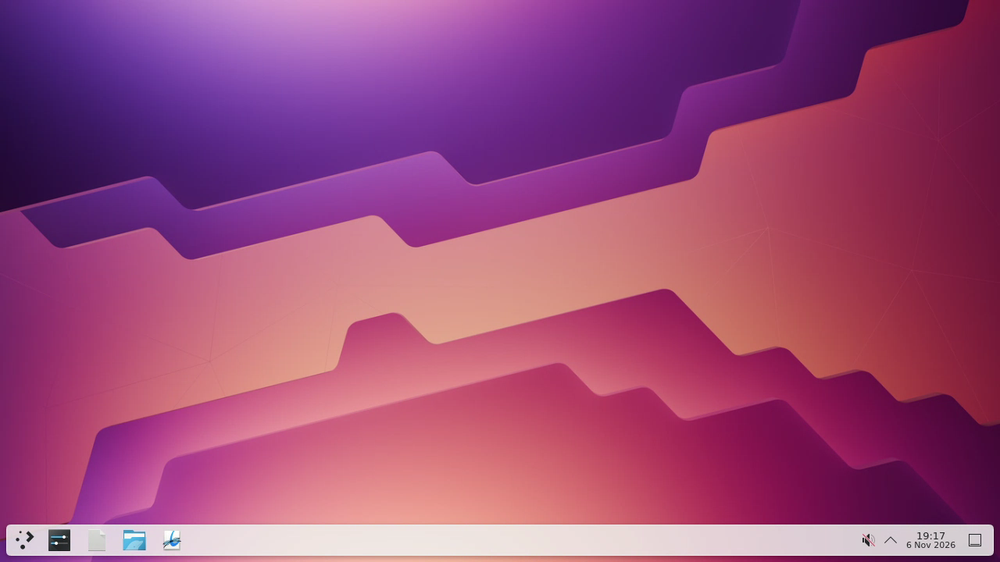

# KDE desktop feasibility record

This is the historical feasibility record. The password-gated application was subsequently built; see [deployment validation](deployment.md) for its current status and limits.

Test date: 2026-11-06. Project: `foxbard-demo`, `prj_FmEBPE4H8628ZRLCJVvfwRIOCFAg`. Team plan: active Hobby, verified through Vercel's team API. Region: `iad1`.

## Result

Neko's transport is promising, but the plan's browser acceptance gate has not passed. No production deployment, entry page, session gateway, or idle-session controller has been built. The repository contains runnable feasibility probes, a lockfile, and the captured frame. The noVNC fallback has not been tested because Neko delivered video successfully in the native-client test.

| Check | Evidence | Status |
| --- | --- | --- |
| KDE image boots on Vercel | Imported image boots directly as a Sandbox, with KDE processes owned by `neko` | Passed |
| HTTPS login | Incorrect password returned 401; correct password returned 200 | Passed at API level |
| Signaling | Authenticated WebSocket connected and exchanged offers and ICE candidates | Passed |
| Unauthenticated direct access | API returned 401; WebSocket sent `system/disconnect` and closed without desktop state | Passed for Neko APIs; HTTP upgrade itself was accepted |
| Desktop video | Direct-image test decoded 964 frames in 40 seconds at 1280×720 | Passed with native client |
| Desktop appearance | Decoded frame shows KDE wallpaper and its panel | Inspected below |
| Input channel | WebRTC data channel opened; an X event-check window received mouse and keyboard press/release events | Passed with native client |
| Two simultaneous clients | Both native clients decoded 959 frames at 1280×720 in the same 40-second test | Passed with native clients; browsers untested |
| Filesystem persistence | `/home/neko/persistence-probe.txt` survived stop/resume | Passed |
| KDE setting persistence | `kdeglobals`, group `KDE`, key `SingleClick=false`, survived stop/resume | Passed using KDE configuration tools |
| Process recovery | No desktop processes survived resume; explicit restart restored service | Passed |
| Browser login and video | User confirmed login and visible KDE wallpaper/taskbar | Confirmed by user |
| Browser keyboard and mouse | User reported clicks did nothing; control on click was disabled and no session held control | Configuration and cursor crash fixed; native input regression passed |
| Full application authentication | Entry page and gateway not implemented | Not tested |
| Reconnect, logout, expiry, startup errors, visitor-based idle shutdown | Application not implemented | Not tested |

No external host or TURN relay was used. Neko advertised Google's public STUN server for ICE discovery. This was a single client-network test; success does not establish that every cofounder's browser or network can connect.

## Image and startup

Upstream image: `ghcr.io/m1k1o/neko/kde:latest`, resolved digest `sha256:216f06a4a12ec04c29b3d8bd3db7d03ce459146a7681435e48287fb004b87216`.

Vercel image: `neko-kde@sha256:e580957c91acb502522d62d0f0b1273e915e667ca71320c7f3fedd23cdd80ba7`. VCR reported it ready, `linux/amd64`, with 1,387,498,172 compressed bytes. The image was copied from the upstream registry through a temporary Vercel Sandbox because local Docker socket access was unavailable. The build Sandbox was stopped after upload.

Sandbox does not run the container's command automatically. Start D-Bus and `/usr/bin/supervisord -c /etc/neko/supervisord.conf` explicitly. Privileged commands filtered the configured environment, so the probe passes `USER=neko`, the display, and test passwords as explicit `env` arguments. The initial direct-image startup ran as root and did not receive the intended password configuration; it was stopped and corrected before the successful media test. Clear stale X display locks and the D-Bus PID file after a stopped session resumes.

The saved startup command reached local HTTP readiness in 6,443 ms after obtaining the Sandbox handle. This is one warm resume measurement, excludes handle acquisition, and is not an estimate of first-time image import or end-to-end browser readiness.

## Limits and cost

The account is on Hobby. Current [Sandbox pricing and quotas](https://vercel.com/docs/sandbox/pricing) list 45-minute sessions, 5 active CPU hours/month, 420 GB-hours of memory/month, 20 GB/month of transfer, and 15 GB of snapshot storage. Exceeding Hobby's included quotas pauses new Sandbox creation; it does not automatically upgrade the plan.

The probe uses 2 vCPUs and 4 GB memory. One running hour consumes 4 GB-hours of the memory allowance. CPU and network usage depend on desktop activity and viewers. The observed direct-image session used 49.29 active CPU seconds over 260.27 elapsed seconds and sent about 5.9 MB; it included startup and a short media test, so it does not establish steady-state streaming cost. On Hobby, Sandbox compute remains $0 within the quotas. No upgrade was made.

[VCR lists image storage at $0.10/GB](https://vercel.com/docs/container-registry/limits-and-pricing); the 1.387 GB image represents about $0.14 at that listed rate. The test snapshot was about 1.418 GB. The initial test kept one snapshot for 24 hours. After installing the requested developer tools, retention changed to one snapshot without automatic expiration. Production retention must be selected explicitly before claiming durable home storage.

## Remaining acceptance work

1. Use an available browser outside Vercel, or obtain approval to use headless Chromium for the test. Verify login, rendered video, keyboard, mouse, and two browser visitors sharing the desktop.
2. If Neko fails those checks because of its media transport, test KDE with noVNC over the exposed HTTPS/WebSocket endpoint.
3. After a transport passes, implement the entry page and server-side session flow. Protect lifecycle APIs and direct Sandbox HTTP/WebSocket access; Neko's own API authentication is only one part of that requirement.
4. Implement service recovery, reconnect, logout, expiry messages, and shutdown after 15 minutes with no connected visitors. Handle the Hobby session limit without losing home files or settings.
5. Repeat persistence tests through the browser, verify failure states, and deploy only after the complete acceptance suite passes.

## Probe validation

The lifecycle scripts were exercised against the linked project: stop, start, status, and read-state. The saved media probe was run against the resumed Sandbox. Both JavaScript files passed `node --check`, and `git diff --check` passed. `npm audit` reported zero vulnerabilities after overriding the CLI configuration dependency to the compatible patched Zod 4.6.7 release.

At the initial feasibility handoff, both test Sandboxes were stopped. The imported VCR image remains available, and the named KDE test Sandbox retains its latest snapshot for 24 hours. No cofounder-facing URL is ready.

## Control fix

The user later started the desktop and confirmed visible KDE but no response to clicks. The room reported `implicit_hosting=false`, `has_host=false`, and the user profile allowed hosting. Enabled `implicit_hosting` through the running room API and added `NEKO_SESSION_IMPLICIT_HOSTING=true` to startup. No restart or password change was required. A temporary X event-check window received `ButtonPress`, `ButtonRelease`, `KeyPress` for `k`, and `KeyRelease` through the external WebRTC data channel. The window and test session were then closed. The desktop remains running for the user, subject to its session timeout.

## Developer tools and follow-up fixes

The user confirmed that control on click worked, then stopped after refresh. Neko logs showed a null-pointer crash while reading the X11 cursor. The patched binary handles missing cursor images; the supervisor command now retains control-on-click across restarts. See [the patch record](../patches/README.md).

Konsole, language runtimes, Docker Engine, and Hermes were installed in the persistent desktop. Docker Desktop was blocked by missing KVM support; Docker Engine passed a container execution test. The user configured OpenRouter privately in the desktop. A Neko chat bridge connects to Hermes through its gateway and supports desktop actions, approval replies, and cancellation. See [the setup and validation record](desktop-tools.md).
